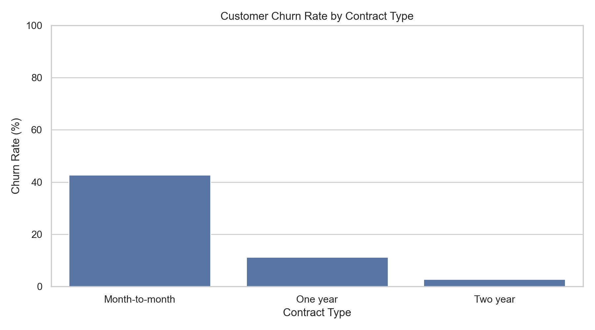
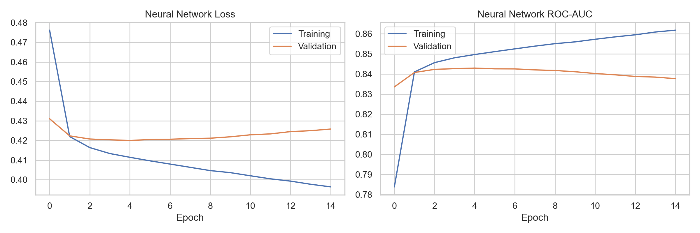
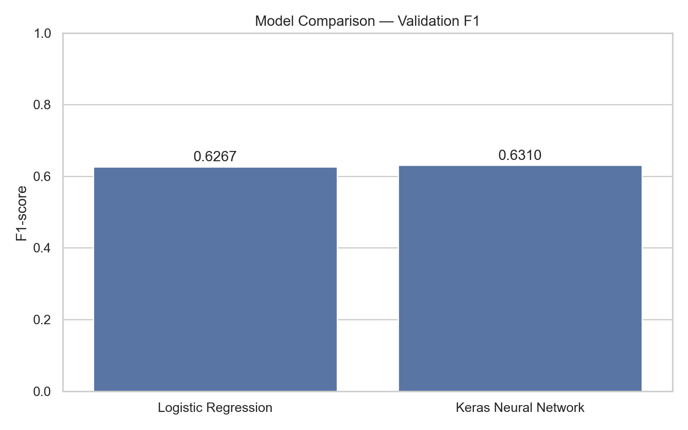
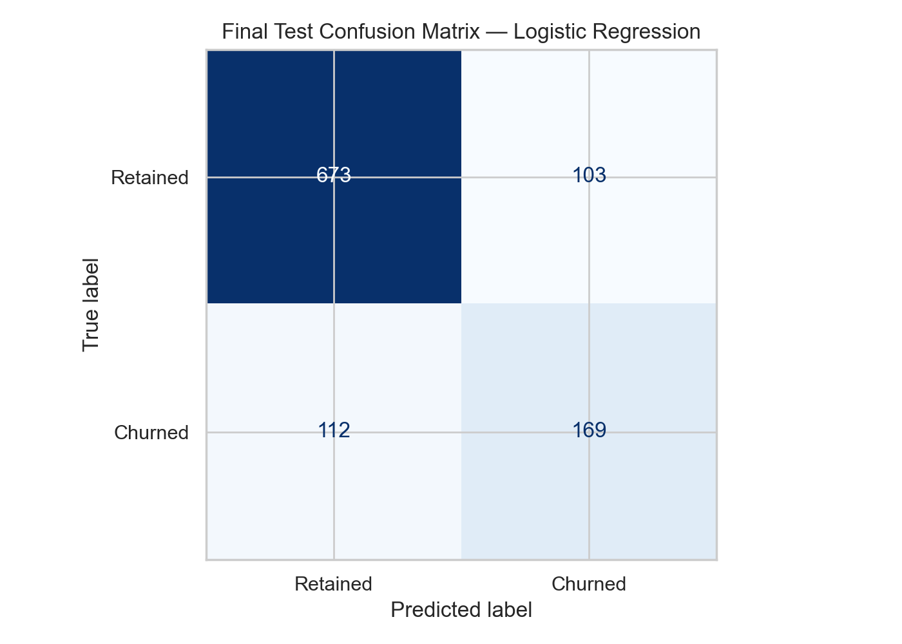

# Customer Churn Prediction Using Machine Learning & Keras

**End-to-End Classification | Python | Scikit-learn | TensorFlow/Keras | Customer Analytics**

## Project Overview

Customer churn is a major challenge for subscription-based businesses. Identifying customers who are likely to leave can help organizations prioritize retention efforts, improve customer engagement, and allocate marketing resources more effectively.

This project develops and evaluates machine learning models to predict customer churn using the IBM Telco Customer Churn dataset.

I compared a Logistic Regression baseline against a Keras Artificial Neural Network (ANN), optimized classification thresholds, and evaluated the selected model on an independent test dataset.

**Key Result:** The final Logistic Regression model achieved a **ROC-AUC of 0.8447**, identifying **60.14% of actual churners** while flagging **25.7% of customers** for potential retention outreach.

## Business Problem

Telecommunications companies face recurring revenue losses when customers cancel their subscriptions.

Retention campaigns can be costly, particularly when discounts or incentives are offered to customers who would have remained without intervention.

The business objective is to develop a predictive model that can:

- Identify customers with elevated churn risk.
- Prioritize customers for targeted retention outreach.
- Balance the identification of churners against unnecessary customer contact.
- Support more data-driven customer retention strategies.

The project focuses on **predicting churn risk**, rather than estimating the causal impact of retention campaigns.

## Dataset

**Source:** [IBM Telco Customer Churn — Kaggle](https://www.kaggle.com/datasets/blastchar/telco-customer-churn)

The dataset contains approximately **7,043 customer records** with information about demographics, account tenure, subscription services, payment methods, and billing.

**Target Variable:** `Churn`

- `Yes`: Customer churned.
- `No`: Customer remained.

### Key Features

| Category | Example Features |
|---|---|
| Customer demographics | SeniorCitizen, Partner, Dependents |
| Account information | tenure, Contract, PaperlessBilling |
| Subscription services | InternetService, OnlineSecurity, TechSupport |
| Billing information | MonthlyCharges, TotalCharges, PaymentMethod |

## Methodology

### 1. Exploratory Data Analysis
### Churn Rate by Contract Type

Investigated customer churn patterns across contract types, tenure, monthly charges, internet services, and additional subscription features.

The analysis explored relationships between customer characteristics and churn to inform subsequent modeling.

### 2. Data Cleaning & Preprocessing

- Converted `TotalCharges` from text to numeric values.
- Handled missing numerical values using median imputation.
- Imputed missing categorical values using the most frequent category.
- Applied standard scaling to numerical features.
- One-hot encoded categorical features.
- Removed customer identifiers and target-derived features from model inputs.

Preprocessing was fitted exclusively on training data to reduce data leakage.

### 3. Train, Validation & Test Split

Used a stratified data split to preserve the churn distribution:

| Dataset | Proportion | Purpose |
|---|---:|---|
| Training | 70% | Train model parameters |
| Validation | 15% | Compare models and select thresholds |
| Test | 15% | Evaluate final generalization performance |

The test dataset remained untouched during model selection and threshold optimization.

### 4. Model Development
### Neural Network Training History

**Logistic Regression**

Developed an interpretable baseline classification model using Scikit-learn.

**Keras Artificial Neural Network**

Developed a feedforward neural network consisting of:

- Input layer using preprocessed customer features.
- First hidden layer with 32 neurons and ReLU activation.
- Second hidden layer with 16 neurons and ReLU activation.
- Sigmoid output layer for binary churn prediction.

The network was trained using the Adam optimizer, binary cross-entropy loss, and early stopping based on validation loss.

### 5. Model Evaluation & Threshold Optimization

Evaluated both models using:

- Accuracy
- Precision
- Recall
- F1-score
- ROC-AUC
- Confusion matrices

Optimized classification thresholds using validation F1-score to balance precision and recall.

## Model Comparison
### Validation Model Comparison

| Model | Optimal Threshold | Validation F1-score |
|---|---:|---:|
| Logistic Regression | 0.45 | 0.6267 |
| Keras Neural Network | 0.30 | 0.6310 |

Although the neural network achieved a slightly higher validation F1-score, its improvement was only **0.0043**.

Using a predefined selection rule requiring an improvement greater than 0.01 to justify the additional complexity, Logistic Regression was selected as the final model.

This illustrates that a more complex model does not necessarily provide a meaningful practical improvement over a simpler baseline.

## Final Test Results
### Final Test Confusion Matrix

**Selected Model:** Logistic Regression

**Classification Threshold:** 0.45

| Metric | Test Performance |
|---|---:|
| Accuracy | 79.66% |
| Precision | 62.13% |
| Recall | 60.14% |
| F1-score | 0.6112 |
| ROC-AUC | 0.8447 |

The final model demonstrated useful discriminatory performance, achieving a ROC-AUC of 0.8447 on unseen test data.

## Business Interpretation

The final test dataset contained **1,057 customers**, including **281 actual churners**.

### Customer Outreach Results

| Outcome | Customers |
|---|---:|
| Customers evaluated | 1,057 |
| Actual churners | 281 |
| Customers flagged for outreach | 272 |
| Churners correctly identified | 169 |
| Churners missed | 112 |
| Retained customers incorrectly flagged | 103 |
| Retained customers correctly identified | 673 |

### Key Takeaways

**1. Targeted Customer Identification**

The model identified approximately 60% of actual churners while flagging only 25.7% of customers for potential retention outreach.

**2. Precision-Recall Trade-off**

Of the 272 customers flagged for outreach, 169 actually churned, corresponding to a precision of 62.13%.

The remaining 103 customers represent potential unnecessary outreach if every flagged customer receives a retention intervention.

**3. Model Simplicity vs. Complexity**

Logistic Regression provided comparable validation performance to the neural network while offering greater interpretability and simpler deployment.

**4. Predictive Accuracy vs. Retention Impact**

Correctly predicting churn does not demonstrate that a retention campaign would prevent it.

Additional experimentation is required to measure incremental retention and financial returns.

## Business Recommendations

### 1. Prioritize High-Risk Customers

Use predicted churn probabilities to identify customers who may benefit from proactive retention outreach.

Consider outreach capacity and customer value when determining which customers to contact.

### 2. Develop Segment-Specific Retention Strategies

Investigate churn patterns across customer tenure, contract type, service subscriptions, and billing characteristics to inform targeted retention strategies.

Observed associations should not automatically be interpreted as causal relationships.

### 3. Validate Campaign Effectiveness Through A/B Testing

Conduct randomized experiments comparing targeted retention interventions against an appropriate control group.

Measure incremental retention, intervention costs, and customer value to determine whether the strategy generates positive business returns.

### 4. Monitor Model Performance

Track changes in churn rates, precision, recall, ROC-AUC, and customer characteristics.

Periodically reassess model performance and classification thresholds as customer behavior evolves.

## Limitations & Future Improvements

- The dataset represents a specific telecommunications customer population and may not generalize to other industries.
- The model predicts churn risk but does not estimate the effect of retention interventions.
- Threshold optimization maximized F1-score rather than expected financial value.
- Model performance may change as customer behavior evolves.
- Future improvements could include probability calibration, additional model comparisons, and business-cost-based threshold optimization.
- A future uplift modeling approach could help identify customers whose retention outcomes are most likely to change because of an intervention.

## Tools & Technologies

| Category | Technologies |
|---|---|
| Programming | Python |
| Data Analysis | Pandas, NumPy |
| Visualization | Matplotlib, Seaborn |
| Machine Learning | Scikit-learn |
| Deep Learning | TensorFlow, Keras |
| Model Evaluation | Precision, Recall, F1-score, ROC-AUC |
| Development Environment | Jupyter Notebook |

## Conclusion

This project demonstrates an end-to-end machine learning workflow combining customer analytics, preprocessing, classification modeling, neural networks, threshold optimization, and business interpretation.

The final Logistic Regression model achieved a **test ROC-AUC of 0.8447** and identified **60.14% of actual churners**, while flagging **25.7% of customers** for potential outreach.

The results illustrate how predictive analytics can support customer retention prioritization while highlighting the importance of model interpretability, operational trade-offs, and experimental validation.
